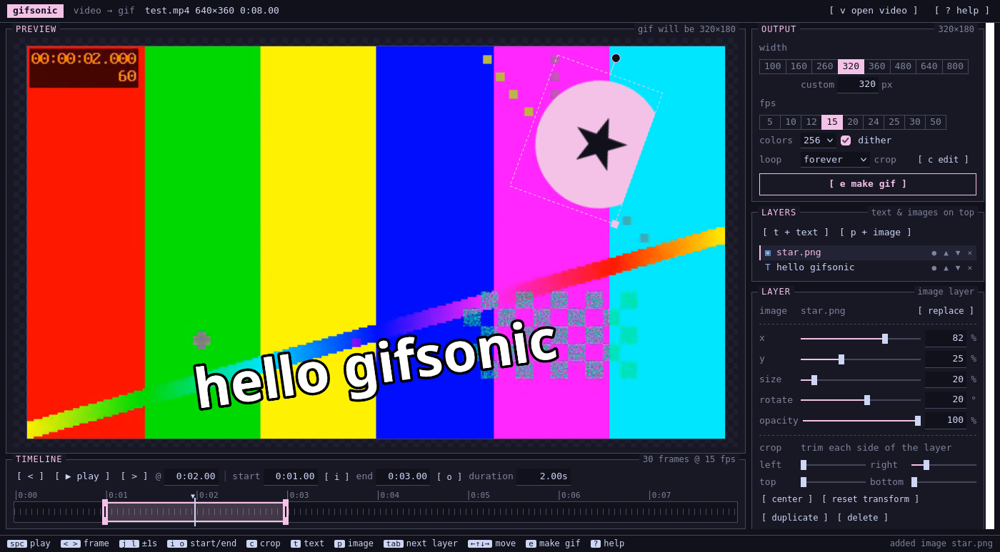

# gifsonic

Turn videos into GIFs — with a terminal-style interface that's still easy to
use with a mouse.



## Features

- **Scrub** the video on a timeline, drag the start/end handles, or type exact
  times (`12.5` or `1:02.5`). Step frame by frame with <kbd>&lt;</kbd> <kbd>&gt;</kbd>.
- **Duration & fps**: set start, end or duration; 5–50 fps.
- **Sizes**: 100, 160, 260, 320, 360, 480, 640, 800 px wide, or any custom width.
- **Crop** the video by dragging, with free / 1:1 / 4:3 / 16:9 / 9:16 aspect.
- **Text & image layers** on top: move, resize and rotate them by dragging
  (or with the keyboard), trim (crop) each side, change opacity, reorder, hide.
  Text has font, bold/italic, alignment, colour, outline and background box.
- **Layer timing**: choose when each text/image appears and disappears, with
  optional fade in / fade out.
- **Edit the gif or an item**: click a text/image in the preview and the
  timeline handles set *when it shows*, and crop trims *it*; click empty space
  (or press <kbd>g</kbd>) to go back to editing the gif. Drag the top edge of a
  highlighted span to slide it along the timeline.
- **Good, small GIFs**: built-in encoder with a shared palette, optional
  dithering, and frame-to-frame optimisation (only changed pixels are stored).
- **Private**: everything runs on your computer. Nothing is uploaded.
- **No lost work**: closing the window before you've saved a GIF asks first.
- **Keyboard-driven** if you want it: press <kbd>?</kbd> in the app for all shortcuts.

## Install (Linux)

Needs Python 3. `ffmpeg` is recommended (for converting unusual video formats).

```sh
git clone https://github.com/wagidevnull/gifsonic.git
cd gifsonic
./install.sh
```

The installer puts gifsonic in your app menu and adds a `gifsonic` command —
no root needed. It offers to install
[pywebview](https://pywebview.flowrl.com/) + WebKitGTK so gifsonic opens in
its own native window; skip that and it uses a browser window instead.

```sh
gifsonic              # open the app
gifsonic clip.mp4     # open a video straight away
```

You can also right-click a video in your file manager → *Open with gifsonic*.
GIFs are saved to `~/Pictures/gifsonic` (override with `GIFSONIC_SAVE_DIR`).

Update: `git pull && ./install.sh`. Uninstall: `./install.sh --uninstall`.

### Without installing

gifsonic is a plain web page, so you can also just open `index.html` in a
browser. It works the same, except videos your browser can't play natively
(some MKV/MOV/HEVC files) can't be converted, and GIFs are downloaded instead
of saved to `~/Pictures/gifsonic`.

## Keyboard

| Key | Action |
|---|---|
| <kbd>space</kbd> | play / pause the selection |
| <kbd>&lt;</kbd> <kbd>&gt;</kbd> (or <kbd>,</kbd> <kbd>.</kbd>) | step one GIF frame |
| <kbd>j</kbd> <kbd>l</kbd> | step one second |
| <kbd>i</kbd> / <kbd>o</kbd> | set start / end at the playhead |
| <kbd>g</kbd> | switch between editing the gif and the selected item |
| <kbd>{</kbd> <kbd>}</kbd> | slide the span being edited by one frame |
| <kbd>c</kbd> | crop the gif, or the selected item |
| <kbd>t</kbd> / <kbd>p</kbd> | add text / image layer (you can also drop or paste images) |
| <kbd>tab</kbd> | select next layer |
| arrows | nudge layer (<kbd>shift</kbd> = 10 px) |
| <kbd>+</kbd> <kbd>-</kbd> / <kbd>r</kbd> <kbd>R</kbd> | resize / rotate layer |
| <kbd>del</kbd> | delete layer |
| <kbd>e</kbd> | make the GIF |

## How it works

The interface is HTML/CSS/JS with no dependencies or build step. Frames are
grabbed from the video with a `<canvas>` and encoded by gifsonic's own GIF
encoder (`js/gif-encoder.js`) in a background worker. The `gifsonic` launcher
is a small Python script that serves the app on `127.0.0.1` with a random
token, opens the window, and handles ffmpeg conversion and saving.

## License

MIT — see [LICENSE](LICENSE).
